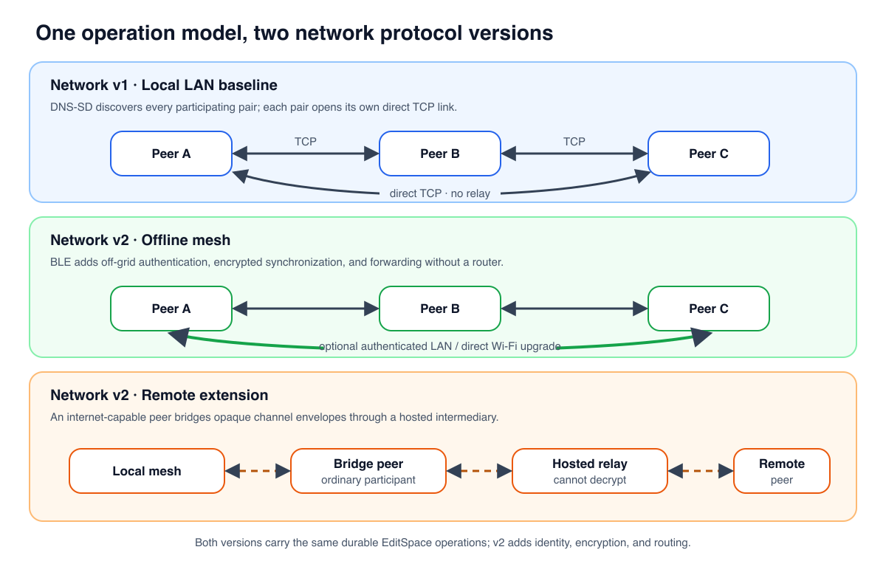
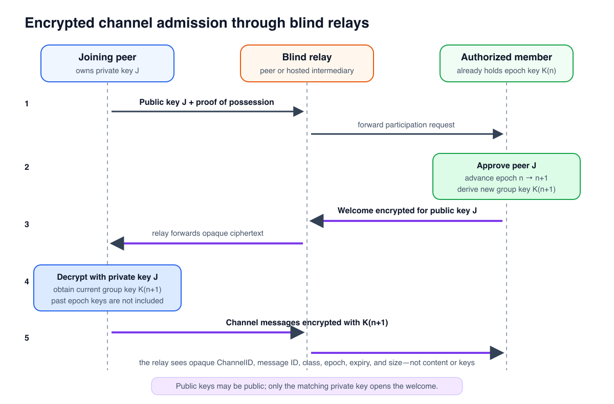
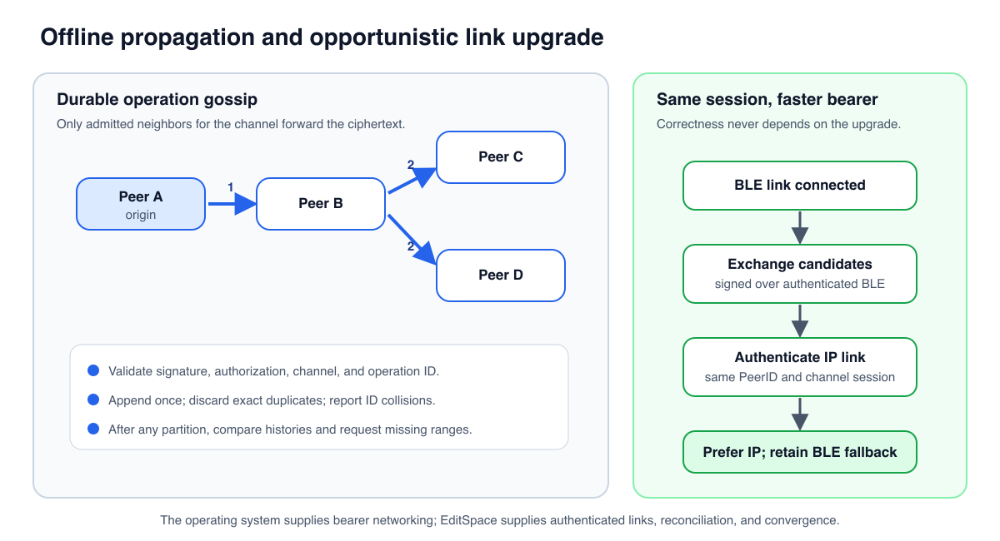

# EditSpace Networking Protocol

Updated: October 2026  
Status: draft specification

The key words MUST, MUST NOT, REQUIRED, SHOULD, SHOULD NOT, and MAY are to be interpreted as described by RFC 2119 and RFC 8174 when they appear in uppercase.

## Contents

- [1. Scope](#1-scope)
- [2. Protocol overview](#2-protocol-overview)
- [3. Common terminology](#3-common-terminology)
- [4. Version negotiation](#4-version-negotiation)
- [5. Network Protocol v1](#5-network-protocol-v1)
- [6. Network Protocol v2](#6-network-protocol-v2)
- [7. Potential Network Protocol v3](#7-potential-network-protocol-v3)
- [8. Conformance and development](#8-conformance-and-development)

## 1. Scope

This document specifies how EditSpace endpoints discover peers, establish links, exchange durable operations, recover missing history, and optionally provide secure routed collaboration.

The networking protocol is versioned independently from the EditSpace operation schema:

~~~text
network protocol version
    discovery, connection, framing, synchronization, security, and routing

operation schema version
    the representation and meaning of EditSpace operations
~~~

Network v1 is the minimum interoperable LAN protocol. It is intended to be straightforward to implement in Blender Python, Apple applications, Android applications, Meta Quest applications, desktop tools, and headless processes.

Network v2 extends the v1 synchronization model with cryptographic peer identity, authenticated admission, encrypted channels, BLE/off-grid links, peer forwarding, URL or QR invitations, and hosted remote relay connections.

This document does not alter operation validation, ordering, merge, or materialization semantics defined by the core EditSpace specification.

## 2. Protocol overview

| Capability | Network v1 | Network v2 |
| --- | --- | --- |
| DNS-SD discovery on a LAN | Required | Required by LAN profile |
| Direct TCP peer links | Required | Required by LAN profile |
| Length-prefixed JSON frames | Required | Required by LAN profile |
| History reconciliation | Required | Required |
| Multiple direct peers | Required | Required |
| Confidentiality | None | End-to-end encrypted channels |
| Cryptographic peer identity | No | Required |
| Channel admission and rekeying | No | Required |
| Peer forwarding | No | Offline-mesh profile |
| BLE transport | No | Offline-mesh profile |
| Hosted intermediary | No | Remote profile |
| URL or QR invitation | No | Remote profile |
| Spatial alignment messages | No | Spatial profile |

## 3. Common terminology

**Endpoint**  
An application or process implementing an EditSpace networking version.

**Peer ID**  
An endpoint identifier. In v1 it is an untrusted random identifier. In v2 it is derived from a cryptographic public key.

**Operation version**  
The version of an EditSpace operation or envelope schema, independent of the networking version.

**Space**  
A shared EditSpace scene identified by the core protocol `doc` value.

**Link**  
A bidirectional byte or message transport between two immediate peers.

**Neighbor**  
A peer connected by a direct link.

**Channel**  
A v2 membership, encryption, synchronization, and routing scope.

**Relay**  
A v2 peer or hosted intermediary that forwards opaque envelopes.

## 4. Version negotiation

### 4.1 Initial hello

Every TCP connection begins with an unencrypted `networkHello` control message using the v1 frame encoding. Its control schema version is always `1`, including when peers intend to select network v2.

~~~json
{
  "kind": "editspace.network.hello",
  "v": 1,
  "networkVersions": [1, 2],
  "operationVersions": [1],
  "peerID": "4d612e1c-fced-42a0-9a61-c1cb34d6b33f",
  "capabilities": ["dns-sd", "tcp", "history-ranges"],
  "spaces": ["space-123"]
}
~~~

`networkVersions` and `operationVersions` MUST be nonempty arrays of unique positive safe integers in descending preference order. `capabilities` and `spaces` MUST contain unique strings. A v1-only endpoint MUST advertise exactly `networkVersions: [1]`.

Peers MUST select the highest numerical network version both advertise and locally permit. They MUST independently select a mutually supported operation version. If either intersection is empty, the peers MUST close the connection and MAY first send `networkError`.

### 4.2 Downgrade protection

A v2 implementation MAY select v1 only when local policy explicitly permits an unencrypted trusted-LAN session. A secure channel or remote invitation MUST set:

~~~json
{
  "minimumNetworkVersion": 2,
  "encryptionRequired": true
}
~~~

Such a session MUST NOT continue as v1. A peer MUST NOT interpret an inability to complete v2 authentication as permission to retry using v1.

### 4.3 Capability negotiation

Capabilities describe optional behavior and MUST NOT remove requirements of the selected version and profile. Unknown capability tokens MUST be ignored. A token SHOULD use lowercase ASCII words separated by hyphens. Extension tokens SHOULD use a reverse-DNS prefix.

## 5. Network Protocol v1

**Section 5 contents**

- [5.1 Purpose and boundary](#51-purpose-and-boundary)
- [5.2 Peer identity](#52-peer-identity)
- [5.3 DNS-SD discovery](#53-dns-sd-discovery)
- [5.4 TCP peer links](#54-tcp-peer-links)
- [5.5 Frame encoding](#55-frame-encoding)
- [5.6 Control messages](#56-control-messages)
- [5.7 Synchronization](#57-synchronization)
- [5.8 Multiple-peer behavior](#58-multiple-peer-behavior)
- [5.9 Platform bindings](#59-platform-bindings)
- [5.10 Security considerations](#510-security-considerations)
- [5.11 Conformance](#511-conformance)

### 5.1 Purpose and boundary

V1 provides automatic discovery and operation synchronization between directly connected peers on a trusted local IP network:

~~~text
advertise and browse _editspace._tcp.local.
→ establish one TCP connection for each peer pair
→ exchange networkHello
→ exchange spaceSelection
→ reconcile retained histories
→ exchange live EditSpace operations
~~~

V1 deliberately does not define:

- encryption or transport confidentiality;
- authentication or authorization;
- invitation codes;
- BLE;
- peer-to-peer forwarding;
- hosted intermediaries;
- NAT traversal;
- asset byte transfer;
- application-specific presence behavior beyond the core EditSpace presence envelope; or
- standardized spatial-alignment semantics.

V1 endpoints advertising the optional `application-messages` capability can
carry ephemeral application-defined payloads. These payloads are deliberately
separate from durable EditSpace history; the base protocol defines their
delivery and framing, but not application-specific meaning.

V1 applications MUST describe the mode as unencrypted. They MUST NOT claim that a v1 Peer ID proves a device, person, account, or operation author.

### 5.2 Peer identity

On first use, an endpoint MUST generate a random UUID and persist it as its v1 Peer ID. Producers MUST encode it as a lowercase RFC 4122 UUID string with hyphens.

The Peer ID is used only for:

- recognizing the endpoint after reconnect;
- ignoring the endpoint's own DNS-SD advertisement;
- deterministically choosing which peer initiates TCP; and
- indexing connection and synchronization state.

Deleting application data MAY generate a new Peer ID. Copying one installation's Peer ID to another concurrently running endpoint is invalid.

Peer IDs are transport identities, not operation actor IDs. One endpoint MAY store operations from multiple actors, and the same actor MAY use different endpoints. V1 does not authenticate either identifier or bind one to the other.

### 5.3 DNS-SD discovery

#### 5.3.1 Service

A v1 endpoint MUST advertise and browse the DNS-SD service:

~~~text
service type: _editspace._tcp
domain:       local.
full type:    _editspace._tcp.local.
~~~

The DNS-SD SRV record supplies the listening host and TCP port. An endpoint SHOULD request an ephemeral listening port from the operating system rather than hard-code one. The service instance name is presentation metadata and MUST NOT be used as peer identity.

The v1 wire service name is `_editspace._tcp` and MUST NOT be changed by platform bindings. Formal service-name registration is a deployment task and does not alter the wire value.

#### 5.3.2 TXT record

A v1 advertisement MUST contain these TXT keys:

| Key | Value |
| --- | --- |
| `net` | Comma-separated supported network versions, highest first; v1-only is `1` |
| `ops` | Comma-separated supported operation versions, highest first |
| `peer` | Canonical v1 Peer ID |
| `caps` | Comma-separated capability tokens; MUST include `tcp` and `history-ranges` |

TXT keys are lowercase ASCII. Each required key occurs exactly once. `net` and `ops` contain unique positive safe integers in descending numerical order, encoded in base ten without signs, whitespace, or leading zeroes. `caps` contains unique lowercase ASCII tokens in lexical order. Empty list elements are invalid.

Each DNS-SD `key=value` string MUST be at most 255 UTF-8 bytes, and the complete encoded TXT record MUST be at most 1,300 bytes. A producer whose optional capabilities do not fit MUST omit optional capability tokens rather than truncate a value. Unknown keys MUST be ignored. A record with a missing, duplicate, malformed, or unsupported required value is incompatible and MUST NOT trigger a connection.

The `peer` value MUST use the canonical UUID spelling from section 5.2. The `net` and `ops` values are discovery hints; the arrays in `networkHello` are authoritative.

A v1 endpoint MUST NOT advertise space IDs, drawing names, scene contents, participant names, or operation data in DNS-SD.

#### 5.3.3 Discovery behavior

When an endpoint discovers a record with its own Peer ID, it MUST ignore it. When it discovers a compatible remote Peer ID, it evaluates the TCP initiation rule in section 5.4.2.

An endpoint MUST group advertisements by Peer ID. Multiple service instances or addresses carrying one Peer ID describe candidate routes to one endpoint, not distinct peers. The endpoint MUST resolve the SRV target and port and then try the resolved IPv6 and IPv4 addresses according to local address-selection policy. Failure of one address MUST NOT prevent trying another address for the same advertisement.

DNS-SD instance-name collision renaming is valid and has no protocol meaning. A changed SRV target, port, address set, or TXT record replaces the previous candidates for future connection attempts but does not terminate a working TCP link.

Discovery loss does not prove a TCP link is dead. Link viability is determined by the TCP connection. After link failure, the designated initiator MUST retry while a compatible advertisement remains visible. Retries MUST use randomized exponential backoff beginning no later than one second after the first failure and capped at 30 seconds. Reappearance of a service resets the backoff.

An implementation MAY impose a user-visible upper bound on simultaneously participating peers, but it MUST continue browsing so additional candidates remain visible. Candidates beyond the bound MAY remain unconnected or receive an empty selection. The bound MUST permit at least eight simultaneous peers for v1 conformance.

### 5.4 TCP peer links

#### 5.4.1 Listener

Every endpoint MUST listen for TCP connections on its advertised port while its v1 service is active. The endpoint MUST accept IPv4 or IPv6 addresses supplied by DNS-SD resolution according to platform availability.

An inbound connection does not require the caller to have been discovered first. The listener learns the remote Peer ID from `networkHello`. If it has a matching DNS-SD record, the hello Peer ID MUST equal that record's `peer` value. If it has no matching record, it associates the connection with the hello Peer ID after validating the ID and the connection-direction rule.

#### 5.4.2 Deterministic initiator

For two Peer IDs compared as ASCII strings:

- the endpoint with the lexicographically smaller Peer ID MUST initiate; and
- the endpoint with the larger Peer ID MUST wait for the inbound connection.

If simultaneous or stale discovery nevertheless creates duplicate connections, both peers MUST retain the connection initiated by the smaller Peer ID and close the other. A peer MUST have at most one active v1 link to a given Peer ID.

After receiving both hellos, a peer MUST close a connection initiated by the lexicographically larger Peer ID. If more than one correctly directed connection exists, both peers retain the connection whose initiator-side TCP source port is numerically smaller and close the others. This tie-breaker is evaluated using the ports from the established TCP connections and is used only for duplicates between the same Peer IDs.

A connection whose remote Peer ID equals the local Peer ID is invalid and MUST be closed with `peerIDMismatch`. Two different reachable endpoints using the same remote Peer ID are an invalid deployment; an implementation MUST treat them as one peer and MAY report a diagnostic.

#### 5.4.3 Connection lifecycle

Each endpoint MUST send `networkHello` immediately after connection establishment. It MUST NOT send history or operation messages until both hellos have been received and a version pair selected.

TCP delivery does not replace history reconciliation. After every reconnect, peers MUST repeat the procedure in section 5.7.

The v1 connection state machine is:

~~~text
TCP connected
→ hello: exchange networkHello
→ selection: exchange spaceSelection
→ synchronizing: exchange summaries, requests, and batches
→ live: continue batches and repeat reconciliation as needed
→ closed
~~~

In `hello`, only `networkHello` and `networkError` are permitted. In `selection`, only `spaceSelection` and `networkError` are permitted. Synchronization messages are permitted after both selections have arrived. An `applicationMessage` is permitted only in `live` and only when both hellos contain the `application-messages` capability. `networkError` is permitted in every state. A message received before its permitted state, or without its required negotiated capability, is `unexpectedMessage`.

An endpoint MUST allow at least 30 seconds for the remote hello and at least 30 seconds for the remote selection. During synchronization it MUST allow at least 120 seconds without receiving bytes or completing a requested batch before treating the link as stalled. Implementations MAY wait longer. A timeout closes the connection; reconnection begins with a new hello and full reconciliation. TCP keepalive MAY be enabled but does not replace these protocol rules.

The connection is `live` when both peers have reached pairwise completion for every active space. Live connections continue to accept batches and may return to synchronization whenever eligible history changes.

On orderly EOF, reset, timeout, or network change, an endpoint discards partial frames and all connection-scoped summary and request IDs. Durable operations already accepted remain stored. If discovery still supplies a candidate, only the designated initiator reconnects.

### 5.5 Frame encoding

Every v1 frame is:

~~~text
uint32 big-endian payload length
payload-length bytes of UTF-8 JSON
~~~

The payload MUST decode to one JSON object. Duplicate JSON keys, invalid UTF-8, non-object roots, and non-finite JSON numbers MUST be rejected.

A zero-length payload is invalid. A v1 endpoint MUST accept payloads up to and including 16,777,216 bytes and MUST NOT send a larger payload. It MUST reject an oversized length before allocating or waiting for the declared payload. Large operation sets MUST be divided among multiple `operationBatch` messages. A single operation that cannot fit in one conforming frame cannot be transported by v1 and MUST NOT be published into a space advertised through v1.

TCP reads MAY split either the length or payload at any byte. Implementations MUST buffer partial frames and MUST process multiple frames received in one TCP read.

Frames are processed in TCP order. JSON member order and insignificant whitespace have no meaning, and v1 does not require canonical JSON serialization. A framing, UTF-8, duplicate-key, or JSON-root failure is `invalidFrame`: the receiver SHOULD send a fatal `networkError` if it can do so safely, then MUST close the connection. EOF in the middle of a frame discards that frame and closes the connection without accepting its partial contents.

### 5.6 Control messages

#### 5.6.1 Common message rules

Every v1 control message has string `kind` and integer `v` members. `v` is the networking control-message schema version and MUST equal `1`; it is not the selected operation version. Unknown members MUST be ignored and SHOULD be retained when an unmodified message is logged or proxied. Unknown control-message kinds result in `networkError` with code `unsupportedMessage`.

Unless a member says otherwise:

- an identifier is a nonempty string of at most 1,024 Unicode scalar values, as defined by the core specification;
- an array described as unique contains no two structurally equal values;
- protocol string comparison uses Unicode scalar order, never locale collation;
- integers are JSON safe integers in `0...9007199254740991`;
- required members are present and have the stated type; and
- a structurally invalid control message is `invalidMessage`.

A sender MUST NOT emit a control message larger than the frame limit. `networkHello` and `historySummary` are each one indivisible message. An endpoint MUST NOT offer a space whose complete v1 summary cannot fit in one frame.

The selected network version and selected operation version are connection-scoped. Network v1 implementations conforming to this specification MUST support operation version 1. Every operation and space-merge envelope sent on the connection MUST use the selected operation version; v1 performs no schema conversion. An endpoint's advertised `operationVersions` MUST include only versions in which it can represent the complete eligible history of every space offered in that hello. It MUST omit a space that cannot satisfy this rule.

#### 5.6.2 `networkHello`

`networkHello` has:

| Member | Requirement | Meaning |
| --- | --- | --- |
| `kind` | REQUIRED | Exactly `editspace.network.hello` |
| `v` | REQUIRED | Exactly `1` |
| `networkVersions` | REQUIRED | Supported networking versions |
| `operationVersions` | REQUIRED | Supported core operation versions |
| `peerID` | REQUIRED | Sender's Peer ID |
| `capabilities` | REQUIRED | Supported capability tokens |
| `spaces` | REQUIRED | Space IDs the endpoint is willing to offer for local synchronization |

`networkVersions` and `operationVersions` are unique arrays of 1 to 32 positive safe integers in descending preference order. `capabilities` is a unique array of at most 128 strings and MUST contain `dns-sd`, `tcp`, and `history-ranges`. `spaces` is a unique array of at most 4,096 identifiers. A v1-only endpoint emits `networkVersions: [1]`.

On an outbound connection, the remote Peer ID MUST equal the DNS-SD `peer` value used to discover that endpoint. On an inbound connection without a prior matching discovery record, the valid hello establishes the remote Peer ID. Equality detects configuration errors but does not establish trust because v1 is unauthenticated.

After both hellos, each endpoint selects the highest network version present in both arrays and allowed by local policy, then independently selects the highest mutually supported operation version. The endpoints MUST reach the same result. No intersection is respectively `unsupportedNetworkVersion` or `unsupportedOperationVersion` and is fatal.

#### 5.6.3 `spaceSelection`

~~~json
{
  "kind": "editspace.network.space-selection",
  "v": 1,
  "spaces": ["space-123"]
}
~~~

`spaces` is a unique array of at most 4,096 space IDs selected from the spaces offered in the remote endpoint's hello. Each endpoint MUST send exactly one `spaceSelection`, including when the array is empty. Selecting an unoffered space is `invalidSelection` and is fatal.

An offered space becomes active when the remote endpoint selects it. This is mutual consent: one endpoint offered the space and the other explicitly accepted it. If both endpoints offer the same space, either endpoint's selection activates it. The complete active set is the union of the two valid selections and is therefore identical at both endpoints.

Selections cannot be changed on an established v1 connection. To change them, an endpoint reconnects and repeats negotiation. A selection authorizes synchronization only for that connection and does not prove identity or grant durable authority outside local application policy.

#### 5.6.4 `historySummary`

~~~json
{
  "kind": "editspace.network.history-summary",
  "v": 1,
  "summaryID": "summary-a-1",
  "doc": "space-123",
  "actors": [
    {
      "actor": "artist-a",
      "ranges": [[1, 14], [18, 22]]
    }
  ],
  "spaceMerges": {
    "kind": "editspace.space-merges",
    "v": 1,
    "declarations": []
  }
}
~~~

`summaryID` is a connection-unique identifier that MUST NOT be reused. `doc` identifies an active space component. `actors` contains at most one entry per actor and MUST be sorted by actor ID. Each actor entry contains identifier `actor` and nonempty `ranges`. Each range is an inclusive `[first, last]` pair of safe integers with `first <= last`. Ranges MUST be sorted by `first`, non-overlapping, and non-adjacent. They describe every valid durable operation eligible for export to that neighbor under section 5.7; gaps are valid because actor sequences are allocated globally across spaces.

`spaceMerges` is one complete core `editspace.space-merges` envelope using the selected operation version. It contains every retained declaration connected to `doc` that is eligible for export to that neighbor under section 5.7. A receiver MUST validate and apply the declarations before resolving `doc`, checking operation membership, or comparing histories. According to the resulting component, `doc` MUST be its canonical space ID.

The summary is an atomic snapshot. After sending it, the sender MUST retain and be able to return every advertised operation until it sends a newer summary for that space or the connection closes. V1 defines no snapshot replacement for discarded history; an endpoint MUST therefore retain every accepted durable operation and merge declaration for every space it offers.

#### 5.6.5 `requestOperations`

~~~json
{
  "kind": "editspace.network.request-operations",
  "v": 1,
  "requestID": "request-b-7",
  "summaryID": "summary-a-1",
  "doc": "space-123",
  "actors": [
    {
      "actor": "artist-a",
      "ranges": [[4, 7]]
    }
  ]
}
~~~

`requestID` is a connection-unique identifier that MUST NOT be reused. `summaryID` identifies the remote summary being queried. `doc` MUST equal that summary's resolved space. The actor ordering and range rules from `historySummary` apply.

A requester MUST include only sequences advertised by the identified summary and absent from its accepted local history. It MUST NOT have more than 16 incomplete requests outstanding to one peer. Reuse of an ID, an unknown or superseded summary, an unadvertised sequence, or a request outside an active space is `invalidMessage`.

#### 5.6.6 `operationBatch`

~~~json
{
  "kind": "editspace.network.operation-batch",
  "v": 1,
  "requestID": "request-b-7",
  "final": true,
  "doc": "space-123",
  "envelopes": [
    {
      "kind": "editspace.operations",
      "v": 1,
      "doc": "space-123",
      "ops": []
    }
  ]
}
~~~

`requestID` is either the identifier of the request being answered or JSON `null` for unsolicited live delivery. `final` is a boolean. A live batch MUST use `requestID: null` and `final: true`.

`envelopes` contains zero or more core `editspace.operations` envelopes using the selected operation version. Every envelope and included operation MUST resolve to the batch's `doc` space component after applying accepted merge declarations. A receiver validates and imports each operation using the core specification.

For a requested response, every operation MUST have the requested actor and a sequence within a requested range. The responder sends each matching advertised operation exactly once across one or more batches with that `requestID`, in any order. All but the last batch use `final: false`; exactly one last batch uses `final: true`. An empty final batch is valid. A response MUST NOT include live or unrelated operations. A missing advertised operation is `historyUnavailable`; the responder sends a nonfatal error for the request and MUST NOT send a successful final batch.

An exact duplicate is harmless and MUST NOT be appended twice. Reuse of one operation ID for different semantic content is an `operationIDCollision` and MUST be reported. One invalid operation MUST NOT cause valid independent operations in the batch to be discarded.

For one actor, two semantically different operations using the same `seq` are an `actorSequenceCollision`; the later received operation is rejected. A structurally invalid envelope is rejected as a unit, but other envelopes in the batch remain independently processable. Valid independent operations are durably appended before the receiver considers a requested batch complete.

#### 5.6.7 `syncComplete`

~~~json
{
  "kind": "editspace.network.sync-complete",
  "v": 1,
  "summaryID": "summary-a-2",
  "doc": "space-123"
}
~~~

`summaryID` identifies the remote summary against which completion was established. A peer sends `syncComplete` only after all its requests against that summary have received final batches, all valid returned operations are durable, and comparison finds no advertised operation missing locally. Receipt describes pairwise state at that instant; it is not a permanent global-completion claim.

#### 5.6.8 `applicationMessage`

~~~json
{
  "kind": "editspace.network.application",
  "v": 1,
  "messageID": "3dd16cf1-1fa4-4b54-917d-4669f3193627",
  "channel": "org.example.selection",
  "payload": "eyJvYmplY3RJRCI6ImN1YmUtMSJ9"
}
~~~

`applicationMessage` is optional and may be sent only after the connection is
`live`, and only when both endpoints advertised `application-messages` in
`networkHello`. `messageID` identifies one transmission. `channel` is a
nonempty application-defined identifier of at most 128 Unicode scalar values.
`payload` is standard padded base64 representing opaque bytes and MUST decode
to at most 8,388,608 bytes.

Application messages are ephemeral: implementations MUST NOT add them to the
operation repository, include them in history summaries, or replay them after
reconnection. Applications that need durable shared state MUST represent it as
EditSpace operations instead. Unknown channels MUST be ignored. Delivery is
reliable and ordered within the TCP connection, but is not guaranteed across a
disconnect.

The receiver MUST validate the application-message structure and base64
payload before dispatching by channel. Invalid base64 or a decoded payload
larger than 8,388,608 bytes is `invalidMessage`. Ignoring an unknown channel
means taking no application action after successful protocol validation; it
does not permit malformed messages.

The base protocol does not assign meaning to channels. Portable applications
SHOULD publish a separate channel specification including payload schemas and
versioning rules.

The channel `editspace.presence` is reserved by EditSpace. Its payload MUST be
a UTF-8 JSON document conforming to `presence-envelope-v1.schema.json`. This
provides a portable peer display name, actor identity, selection and focus
handshake without relying on a platform-specific discovery framework.
Malformed UTF-8, invalid JSON, or a payload that does not conform to the
presence schema is `invalidMessage`. Valid presence remains ephemeral and MUST
NOT be inserted into durable operation history.

#### 5.6.9 `networkError`

~~~json
{
  "kind": "editspace.network.error",
  "v": 1,
  "code": "unsupportedNetworkVersion",
  "fatal": true,
  "message": "No mutually supported networking version"
}
~~~

`code` is a stable machine-readable token. `fatal` is a required boolean. Optional `message` is diagnostic text and MUST NOT affect behavior. Optional `doc` and `requestID` identify an affected space or request. A receiver MUST NOT answer `networkError` with another error.

| Code | Fatal | Meaning |
| --- | --- | --- |
| `unsupportedNetworkVersion` | yes | No permitted network version intersects |
| `unsupportedOperationVersion` | yes | No usable operation version intersects |
| `unsupportedMessage` | yes | Message kind is unknown |
| `unexpectedMessage` | yes | Message is not permitted in the current state |
| `invalidFrame` | yes | Framing, UTF-8, JSON, or duplicate-key failure |
| `invalidMessage` | yes | Control-message structure or cross-message reference is invalid |
| `invalidSelection` | yes | A peer selected a space it was not offered |
| `peerIDMismatch` | yes | Peer identity conflicts with discovery, self, or connection state |
| `resourceLimit` | yes | A mandatory limit cannot be honored safely |
| `historyUnavailable` | no | An advertised requested operation is unavailable; abort that request and space synchronization |
| `invalidOperation` | no | One operation failed core validation |
| `operationIDCollision` | no | One operation ID has conflicting semantic content |
| `actorSequenceCollision` | no | One actor sequence identifies different operations |

The sender MUST use the listed `fatal` value. After sending or receiving a fatal error, an endpoint MUST close the TCP connection after flushing the error if practical. A nonfatal operation error rejects only the affected operation. `historyUnavailable` aborts the identified request and prevents `syncComplete` for that space on the current connection.

### 5.7 Synchronization

After both `spaceSelection` messages arrive, each peer performs this procedure independently for every active space:

~~~text
send a fresh historySummary
→ apply received space-merge declarations
→ compare retained actor ranges
→ request every missing advertised range
→ receive one or more operationBatch messages through final=true
→ durably validate and append valid operations
→ receive and compare a new historySummary
→ send syncComplete referencing that summary when nothing remains missing
~~~

A peer MUST durably append its own operation before advertising or sending it. Imported operations MUST be appended idempotently before being included in a later summary. A responder MUST send a fresh summary after completing all requests against its preceding summary. A receiver whose accepted history changes during comparison MUST invalidate its local comparison result and compare again.

At most one summary per peer and active space is current. A newer valid summary supersedes the earlier summary after outstanding requests against the earlier summary have completed. Requests already accepted against an older summary remain valid because the sender must retain its advertised snapshot until those requests finish.

Peers MAY request multiple actors or ranges in one request and MAY have up to 16 requests in flight, but request completion does not imply synchronization completion. Only `syncComplete` tied to a post-transfer summary asserts that the receiver has no missing advertised operation at that instant.

After initial synchronization, a peer SHOULD send newly eligible local operations promptly in live `operationBatch` messages to every directly connected peer with that active space. It then sends a new summary. It MUST still reconcile after reconnection because a write to a TCP socket does not prove durable receipt.

V1 history export is neighbor-specific. For a given neighbor, a summary and requested response include only:

- operations and merge declarations authored or created locally;
- operations and declarations explicitly imported and approved for sharing by a local application action; and
- operations and declarations previously received from that same neighbor, so receipt can be confirmed.

An item received from one network neighbor is not eligible for export to a different neighbor merely because it is retained locally. Promoting such an item for wider sharing requires explicit local application action and does not change its immutable wire value. Implementations MUST retain provenance sufficient to enforce this rule.

If new eligible history arrives while summaries are being compared, peers repeat the comparison. Pairwise synchronization converges when both peers have sent `syncComplete` against current summaries. A later local operation, merge declaration, or reconnect begins another reconciliation round.

### 5.8 Multiple-peer behavior

An endpoint MAY maintain direct links to multiple peers:

~~~text
              Peer B
                │
Peer C ───── Blender A ───── Peer D
~~~

V1 is not a mesh-routing protocol. A peer MUST NOT forward an operation or merge declaration received from one neighbor to another merely because both use v1. Each endpoint sends only:

- operations it authored locally; and
- operations explicitly imported into a local space by application action.

Every conforming endpoint MUST attempt a direct link to every discovered compatible endpoint, subject to explicit local participation policy and the minimum eight-peer capacity. Every pair that activates a common space communicates directly. Operation IDs make duplicate direct delivery harmless.

### 5.9 Platform bindings

All platform bindings MUST publish and browse the same DNS-SD service, interpret the same TXT keys, open ordinary TCP streams, and implement the same decoded JSON semantics. JSON whitespace and object-member order MAY differ.

Conformance applies while an endpoint declares its v1 service active. V1 does not require an application to remain active in the background when its operating system suspends networking. Before suspension or intentional shutdown, an endpoint SHOULD withdraw its advertisement and close links when the platform provides time to do so. On resume it republishes, reconnects, and performs full reconciliation.

#### 5.9.1 Apple

Apple implementations SHOULD use Bonjour through Network framework. Applications MUST declare the Bonjour service type and local-network privacy usage required by the target operating system.

#### 5.9.2 Android and Meta Quest

Android implementations SHOULD use Network Service Discovery or another conforming DNS-SD implementation plus ordinary sockets. They MUST account for multicast reception, application lifecycle, network changes, and the permission behavior of supported OS versions.

Meta Quest implementations use the Android binding where the runtime permits it. Conformance MUST be demonstrated on representative Quest hardware; Android API compatibility alone is not proof of multicast behavior.

### 5.10 Security considerations

V1 provides neither confidentiality nor peer authentication. Any party able to observe or modify the LAN may read, inject, alter, replay, or suppress traffic. Peer IDs and offered space IDs are untrusted.

An application MUST require explicit local policy before enabling v1 on an untrusted or public network. Sensitive spaces MUST require v2. A v1 implementation SHOULD make its unencrypted state visible to the user.

Core operation validation and deterministic collision handling remain required, but they do not make an unauthenticated sender trustworthy.

### 5.11 Conformance

A conforming v1 endpoint MUST:

1. advertise and browse the normative DNS-SD service;
2. implement the required TXT keys;
3. establish exactly one TCP link per participating peer pair;
4. implement the frame decoder including partial reads and size checks;
5. implement the connection state machine and required timeout minima;
6. negotiate networking and operation versions;
7. explicitly exchange space selections;
8. implement every v1 control message and stable error behavior;
9. correlate summaries, requests, final batches, and completion IDs;
10. reconcile missing history after every connection;
11. deduplicate immutable operations and report both ID and actor-sequence collisions;
12. preserve provenance and prevent implicit forwarding between neighbors;
13. exchange live eligible operations with all participating direct peers;
14. when advertising `application-messages`, enforce mutual capability
    negotiation, live-state delivery, payload limits, unknown-channel
    handling, and the reserved presence-channel schema; and
15. pass every required v1 networking fixture and deterministic scenario vector.

Interoperability MUST be demonstrated with an independently implemented peer. Two instances of one library are insufficient evidence of cross-platform conformance.

The normative structural schema is `schemas/network-message-v1.schema.json`. Stateful behavior that JSON Schema cannot express—including message order, capability gating, application-message dispatch, presence payload handling, range containment, snapshot retention, collision handling, reconnection, and non-forwarding—is normative in this document and MUST be exercised by the networking vectors listed in `conformance/network-v1/manifest.json`.

## 6. Network Protocol v2

**Section 6 contents**

- [6.1 Status and profiles](#61-status-and-profiles)
- [6.2 Cryptographic peer identity](#62-cryptographic-peer-identity)
- [6.3 Discovery and invitation](#63-discovery-and-invitation)
- [6.4 Peer-link abstraction](#64-peer-link-abstraction)
- [6.5 Session and admission](#65-session-and-admission)
- [6.6 Encrypted collaboration channels](#66-encrypted-collaboration-channels)
- [6.7 Offline mesh](#67-offline-mesh)
- [6.8 BLE binding](#68-ble-binding)
- [6.9 High-throughput upgrade](#69-high-throughput-upgrade)
- [6.10 Remote profile](#610-remote-profile)
- [6.11 Routing and scale](#611-routing-and-scale)
- [6.12 Traffic classes](#612-traffic-classes)
- [6.13 Spatial profile](#613-spatial-profile)
- [6.14 Conformance](#614-conformance)

### 6.1 Status and profiles

V2 is a provisional extension specification. The observable behavior in this part is the design target, but v2 cannot become normative until the group-security suite, authenticated handshake, BLE binding constants, and hosted-relay wire contract are frozen and represented by conformance vectors.

V2 consists of additive profiles:

| Profile | Required behavior |
| --- | --- |
| Secure LAN | Cryptographic identity, authentication, participation, encrypted channels over local IP |
| Offline mesh | BLE discovery and transport, multi-peer forwarding, partition recovery, optional IP upgrade |
| Remote | Hosted-intermediary connection, opaque relay, URL/QR invitation, local/remote bridging |
| Spatial | Independent alignment state and opaque alignment payloads |

An endpoint MAY implement only the profiles relevant to its platform. Blender may implement Secure LAN without BLE or spatial alignment.

### 6.2 Cryptographic peer identity

Every v2 endpoint has a persistent public/private key pair. Its Peer ID is derived from a canonical representation of the public key. Every v2 link MUST prove possession of the corresponding private key.

Peer identity is distinct from:

- an actor that authors operations;
- a person or account;
- display name, color, or avatar;
- a transport address;
- an ARKit participant identifier; and
- a BLE, Wi-Fi, or hosted-relay address.

The same Peer ID persists across simultaneous or replacement BLE, IP, direct-Wi-Fi, and hosted-relay links.

### 6.3 Discovery and invitation

V2 supports:

~~~text
secure LAN:         DNS-SD advertisement
offline mesh:       BLE advertisement
remote profile:     hosted-server URL or QR invitation
~~~

Discovery records expose, within transport size limits:

~~~text
network and operation version ranges
Peer ID and public-key fingerprint
supported link capabilities and profiles
short-lived nonce
expiry
signature
~~~

Records MUST NOT expose space names, drawing names, scene contents, or participant lists.

#### 6.3.1 Local discovery

DNS-SD and BLE produce peer candidates. Candidates authenticate before participation messages are accepted. Application policy MAY automatically request participation or require user approval.

#### 6.3.2 Remote invitation

A remote URL or QR invitation points to the hosted intermediary and carries or securely resolves:

- the intermediary endpoint;
- an unguessable, preferably one-time invitation capability;
- the inviter's Peer ID fingerprint;
- the target space and encrypted channel invitation;
- the requested or permitted role;
- an expiry;
- `minimumNetworkVersion=2`; and
- `encryptionRequired=true`.

Both inviter and invitee connect outward to the intermediary. The invitation permits a participation request; the intermediary is not the membership authority.

### 6.4 Peer-link abstraction

Every v2 transport adapter exposes:

~~~text
PeerLink
    localPeerID
    remotePeerID
    send(frame)
    incomingFrames
    maximumFrameSize
    reliability
    throughputClass
    connectionState
    close()
~~~

Representative throughput classes are `constrained`, `interactive`, and `bulk`. Correctness MUST NOT depend on a particular bearer or on selecting the fastest path.

Profile bindings are:

- Secure LAN: authenticated local IP streams;
- Offline mesh: BLE GATT or L2CAP, optionally direct Wi-Fi exposed as an IP link; and
- Remote: secure WebSocket or an equivalent broadly deployable connection to the hosted intermediary.

### 6.5 Session and admission

Every v2 neighbor link follows:

~~~text
link connected
→ version and capability negotiation
→ authenticated hello
→ participation requested or invited
→ accepted or rejected
→ channel-key admission
→ history reconciliation
→ active participation
~~~

Participation is explicit, scoped to a space and channel, bound to authenticated Peer ID, and expiring where appropriate. Presence MUST NOT grant authorization.

The v2 vocabulary adds authenticated hello, participation request, invitation, acceptance, rejection, resumption, encrypted welcome, key update, subscription, presence, asset, and alignment messages to the common history messages.

### 6.6 Encrypted collaboration channels

A physical EditSpace may contain independent channels:

~~~text
Physical space
├── shared environment channel
├── drawing A channel
├── drawing B channel
├── modelling session C channel
└── presence channel
~~~

Each channel has:

- an opaque random Channel ID;
- independent membership;
- independent end-to-end encryption keys and epochs;
- independent history summaries; and
- an optional asset namespace.

Membership in a physical space does not grant membership in every channel.

#### 6.6.1 Blind relay envelope

A relayed envelope exposes only:

~~~text
protocol version
opaque Channel ID
message ID
message class
key epoch
expiry
ciphertext length
ciphertext and authentication tag
~~~

A relay MAY route by Channel ID, suppress duplicate message IDs, enforce expiry and size limits, and apply backpressure. It MUST NOT require channel decryption keys. Space names, drawing names, operations, object IDs, presence, assets, and membership secrets remain encrypted. Timing and approximate volume remain observable.

#### 6.6.2 Group admission

Group admission follows:

~~~text
joiner sends public key and proof of possession
→ authorized member approves admission
→ channel advances to a new key epoch
→ member creates a welcome encrypted for the joiner
→ relays forward the opaque welcome
→ joiner decrypts it with its private key
~~~

New members receive current keys, not past epoch keys. If authorized to receive history, they receive retained signed operations encrypted under the current epoch. Removing a member advances the epoch and distributes the new secret only to remaining members.

EditSpace MUST adopt a reviewed group-security protocol rather than invent one. Messaging Layer Security, RFC 9420, is the leading candidate. HPKE, RFC 9180, is relevant to recipient-specific welcome material. The selected suite and parameter set remain unresolved.

#### 6.6.3 Durable authenticity

Channel encryption is not a durable authorship record. Forwarded operations require an origin signature or signed attestation covering the space/channel, operation ID, actor, and canonical semantic digest. The attestation remains attached when an operation is forwarded, re-encrypted for another epoch, or replayed from history.

The signing representation MUST be canonical so semantically equivalent JSON produces the same digest.

### 6.7 Offline mesh

Authenticated neighbor links form an application-level peer graph:

~~~text
A ←BLE→ B ←BLE→ C
          │
         BLE
          │
          D
~~~

Durable operations use first-seen propagation:

~~~text
receive operation
→ reject if invalid or unauthorized
→ discard an exact duplicate
→ report an ID collision with different content
→ append a new accepted operation
→ forward it to other admitted neighbors for the channel
~~~

This does not implement IP routing, address assignment, arbitrary tunneling, route discovery, congestion control, or leader election.

Partitions are normal. Each component continues editing, and later neighbor connections repeat pairwise reconciliation until authorized histories converge.

### 6.8 BLE binding

The Offline Mesh profile will standardize:

- service and characteristic identifiers;
- advertisement fields;
- authenticated-handshake framing;
- fragmentation and reassembly;
- flow control and acknowledgements;
- required message-size limits; and
- reconnect behavior.

BLE MUST carry complete durable-operation reconciliation when no faster bearer exists. Large assets MAY remain pending until a suitable link is available.

These constants and encodings remain unresolved and are required before the profile becomes normative.

### 6.9 High-throughput upgrade

When BLE neighbors discover a faster path:

~~~text
BLE session
→ exchange signed link candidates
→ establish an IP link through platform facilities
→ authenticate the same Peer ID
→ reconcile outstanding operations
→ prefer IP for operations and assets
→ retain BLE for fallback or close it
~~~

Possible bearers include a shared LAN, Ethernet, Apple peer-to-peer Wi-Fi, Wi-Fi Aware, Wi-Fi Direct, or a temporary peer-hosted network. These are adapters, not new EditSpace semantics.

If no faster bearer exists, synchronization continues over BLE.

### 6.10 Remote profile

Direct NAT traversal, DHT lookup, and remote peer dialing are outside v2. A remote invitation always names a hosted intermediary. Participants connect outward using secure WebSocket or an equivalent transport.

~~~text
local/offline mesh
        │
internet-connected bridge peer
        │ outbound secure connection
        ▼
hosted intermediary
        ▲
        │ outbound secure connection
remote participant
~~~

The bridge is an ordinary peer with local and remote links. Multiple bridges MAY coexist; duplicate paths are harmless.

The hosted intermediary:

- accepts outbound authenticated transport connections;
- associates them with unguessable routing channels;
- retransmits opaque envelopes;
- enforces resource limits and backpressure; and
- expires inactive connections and routing state.

It MUST NOT decrypt channel payloads, interpret operations, materialize scenes, resolve conflicts, own peer identity, decide membership, or admit a participant while every authorized member is offline.

The server's internal deployment architecture is outside this specification. Its client-visible wire contract remains unresolved.

### 6.11 Routing and scale

Small offline groups MAY forward first-seen channel ciphertext to every admitted neighbor. Large spaces SHOULD avoid all-to-all connections and irrelevant channel traffic.

Scaling mechanisms are:

- separate channels per drawing or session;
- bounded neighbor counts;
- opaque channel subscriptions with expiring leases;
- batched operation envelopes;
- pairwise anti-entropy per channel;
- coalesced, interest-scoped presence; and
- requested rather than flooded assets.

A blind relay may store only:

~~~text
opaque Channel ID → interested neighboring links
~~~

The detailed subscription-routing algorithm remains unresolved.

### 6.12 Traffic classes

#### 6.12.1 Durable operations

Durable operations are retained, attested, deduplicated, encrypted, reconciled after partitions, and forwardable through admitted or explicitly permitted relay peers.

#### 6.12.2 Presence

Presence is expiring, sequenced, coalescible, interest-scoped, and never retained in durable history. It MAY be reduced or disabled on constrained links.

#### 6.12.3 Assets

Assets are content-addressed, encrypted, chunked, resumable, integrity-checked, and requested rather than flooded. Bulk bytes SHOULD prefer high-throughput links and MAY remain pending while only BLE is available.

#### 6.12.4 Direct-neighbor control

Authentication, admission, link negotiation, and link acknowledgements apply only to immediate neighbors and MUST NOT be mesh-forwarded.

### 6.13 Spatial profile

Scene synchronization and physical alignment are independent. The Spatial profile defines alignment state and generic messages while platform-native alignment payloads remain opaque.

~~~text
alignment: notApplicable | unaligned | provisional | confirmed | lost
~~~

Apple adapters may exchange supported ARKit alignment data. Heterogeneous devices may use AprilTags or another portable optical reference. A remote desktop viewer uses a virtual mapping from canonical EditSpace coordinates and does not require physical alignment.

### 6.14 Conformance

A v2 endpoint MUST first satisfy v1 framing, negotiation, synchronization, and recovery behavior where reused by its profiles.

The v2 conformance suite will cover:

- authenticated identity and handshake;
- participation state transitions;
- encrypted welcome and key epochs using fixed test keys;
- downgrade rejection;
- channel isolation and blind relaying;
- duplicate, reordered, and delayed delivery;
- partitions and eventual convergence;
- BLE fragmentation and reassembly;
- multi-peer forwarding;
- BLE-to-IP upgrade;
- hosted-relay bridging;
- presence expiry;
- asset resumption; and
- alignment transitions.

An endpoint claims only the v2 profiles whose required vectors and device qualifications it passes.

## 7. Potential Network Protocol v3

**Section 7 contents**

- [7.1 Status and boundary](#71-status-and-boundary)
- [7.2 Networking and session candidates](#72-networking-and-session-candidates)
- [7.3 Cross-layer candidates](#73-cross-layer-candidates)
- [7.4 Core-message and application candidates](#74-core-message-and-application-candidates)
- [7.5 Possible initial focus](#75-possible-initial-focus)

### 7.1 Status and boundary

V3 is a speculative research space, not a protocol commitment. The candidates in this section have no assigned wire encodings, conformance requirements, compatibility promises, or implementation schedule. Listing an idea here does not mean it belongs in the networking protocol or that a third network version will necessarily be required.

A feature belongs in a future networking version only when it changes discovery, connection establishment, admission, routing, replication, synchronization, transport, or network-visible security invariants. A feature that changes the representation or meaning of durable edits belongs in a future core operation schema. User workflow and rendering behavior belong in application profiles. Cross-layer features require separately versioned contracts at each affected boundary.

New bearers, radios, hosted intermediaries, or optional deployment arrangements SHOULD remain v2 profiles when they do not change the underlying session and synchronization model. V3 should be introduced only for a coherent set of new network invariants, not as a collection of unrelated optional features.

### 7.2 Networking and session candidates

The following are primarily networking, replication, or session-layer ideas:

**Selective replication and interest routing**

Peers could subscribe to spatial regions, collections, layers, entity classes, operation classes, time ranges, or levels of detail rather than retaining an entire space. Summaries and requests would describe subscription scopes, and routing would deliver only authorized relevant history. Correctness rules would have to distinguish a complete subscribed view from an incomplete replica.

**Content-addressed asset distribution**

Assets identified by cryptographic digests could be obtained from any authorized peer, cache, relay, or archive. A profile could define resumable chunks, verification, deduplication, peer-assisted distribution, quality variants, and optional erasure-coded storage without placing large asset bytes in the durable operation log.

**Capability-based authorization**

Cryptographic capabilities could grant narrow, delegable, and offline-verifiable authority: edit particular objects or regions, add annotations, publish bounded assets, invite viewers, or act until an expiry. Network admission and operation acceptance would consume the same capability semantics while remaining separately testable.

**Privacy-preserving discovery**

Rotating discovery identities, encrypted advertisements, invitation-bound discovery, or proofs of shared membership could allow authorized nearby peers to find one another without publicly exposing stable identities, space IDs, or participant lists.

**Store-carry-forward synchronization**

An authorized device could physically carry opaque encrypted history between groups that remain disconnected for hours or days. The protocol would need expiry, replay, duplicate suppression, custody limits, and reconciliation rules for delayed bundles without treating the carrier as a channel member.

**Self-preserving spaces**

A space could express replication and archival requirements, detect loss of complete replicas or assets, and arrange encrypted repair copies among authorized peers. Network state would report durability health without creating a permanently authoritative server.

### 7.3 Cross-layer candidates

These ideas affect networking but also require changes to core identity, message, or application models:

**Federated spaces**

Independently administered spaces could be mounted, referenced, or connected through portals without permanently merging all histories. Networking would route and subscribe across federation boundaries, while the core model would define stable references, namespace behavior, and the meaning of cross-space operations. Each space could retain independent membership, encryption, retention, and ownership policy.

**Distributed spatial consensus**

Peers could reconcile competing anchors, confidence estimates, drift corrections, and indoor/outdoor coordinate transitions into a shared spatial frame. Networking would distribute measurements and consensus state; a spatial schema would define their meaning and privacy rules.

**Portable protocol extensions**

Capability negotiation could advertise schemas or sandboxed deterministic modules for validation, migration, materialization, constraints, or procedural geometry. Distribution and compatibility are networking concerns; execution semantics and deterministic state changes belong to the core protocol. WebAssembly is one possible container but is not selected.

**Autonomous collaborators**

Agents, scanners, robots, procedural systems, and render farms could participate as constrained peers. Networking would provide identity, admission, rate limits, and capabilities, while durable messages would carry provenance, tool or model identity, confidence, reproducibility information, resource budgets, and human-approval requirements.

### 7.4 Core-message and application candidates

These ideas may be valuable to EditSpace but are not, by themselves, reasons for a networking v3:

**Branches, proposals, and review**

Private or shared branches, proposed operation sets, deterministic branch merging, selective undo, checkpoints, review, and time travel primarily change durable history semantics and collaboration workflow. Networking may synchronize branch data after a future core schema defines it.

**Distributed simulation**

Physics, animation, robotics, or game simulation could use deterministic lockstep, authoritative leases, prediction, correction, checkpoints, and transfer of simulation authority. Simulation messages should use an optional application or session profile, and simulation state should become durable EditSpace history only through an explicit commit operation.

### 7.5 Possible initial focus

If a future v3 is justified, the most coherent initial combination is:

1. selective replication and interest routing;
2. federated spaces; and
3. capability-based authorization.

Together they would permit large, independently governed spaces in which no participant or server must store everything. Federation would require coordinated evolution of the networking and core specifications; the other candidates could then be evaluated as profiles rather than assumed v3 requirements.

## 8. Conformance and development

### 8.1 JavaScript conformance system

The JavaScript conformance suite is the executable specification for deterministic, transport-independent decisions. The networking manifest and vectors are versioned independently from the core materialization vectors. Native adapters run the same cases and compare their decoded results structurally.

V1 vectors cover:

- DNS-SD TXT encoding;
- hello version negotiation;
- big-endian frame parsing and partial TCP reads;
- frame-size rejection;
- duplicate-connection resolution;
- explicit space selection;
- permitted message order;
- history-range comparison;
- requested-batch completion;
- duplicate, operation-ID collision, and actor-sequence collision behavior; and
- neighbor-specific export without implicit forwarding.

Passing virtual conformance does not prove DNS-SD interoperability, radio behavior, background execution, throughput, energy use, or hosted deployment reliability. Those require integration and device qualification.

### 8.2 Implementation sequence

This section is non-normative.

#### 8.2.1 Minimum LAN implementation

1. Validate the normative schema and deterministic networking vectors.
2. Implement the Python reference library and Blender queue bridge.
3. Implement Apple and Android bindings.
4. Qualify Blender/Python, Apple, Android, and representative Meta hardware against independent peers.
5. Pursue formal registration of the already-fixed `_editspace._tcp` service name.

#### 8.2.2 Secure LAN

1. Select the authenticated handshake and group-security suite.
2. Define channel admission, canonical attestations, and downgrade vectors.
3. Prove secure LAN interoperability before adding constrained transports.

#### 8.2.3 Offline Mesh

1. Freeze BLE identifiers, framing, fragmentation, and flow control.
2. Prove two-peer reconciliation over BLE.
3. Prove three-peer forwarding, partition, and recovery.
4. Add optional IP upgrade and asset transfer.

#### 8.2.4 Remote and Spatial

1. Freeze the hosted-intermediary client contract.
2. Prove opaque local/remote bridging and duplicate paths.
3. Add native and heterogeneous alignment bindings.

### 8.3 Open issues

V1 has no unresolved wire-design issue. Cross-platform DNS-SD qualification, operating-system permission changes, Blender dependency packaging, and formal service-name registration remain implementation and deployment work; they do not change v1 messages or state transitions.

V2 must resolve before freezing:

- authenticated-handshake and group-security suites;
- canonical operation signing;
- BLE identifiers, MTUs, flow control, throughput, and peer limits;
- representative Quest BLE behavior;
- subscription routing beyond bounded flooding;
- history compaction for intermittent peers;
- encrypted asset resumption;
- hosted-intermediary abuse controls; and
- acceptable traffic-analysis leakage.

### 8.4 Global non-goals

EditSpace networking is not:

- an arbitrary IP mesh, VPN, or replacement network stack;
- a public directory of spaces;
- a general messaging platform;
- a DHT or NAT-traversal protocol;
- an authoritative cloud scene service;
- guaranteed remote connectivity without a hosted intermediary;
- a mechanism for making blind relays channel members; or
- a replacement for USD/USDZ in conventional desktop 3D interchange.

### 8.5 References

- IETF, *Key words for use in RFCs to Indicate Requirement Levels*, RFC 2119: <https://www.rfc-editor.org/rfc/rfc2119.html>
- IETF, *Ambiguity of Uppercase vs Lowercase in RFC 2119 Key Words*, RFC 8174: <https://www.rfc-editor.org/rfc/rfc8174.html>
- IETF, *Multicast DNS*, RFC 6762: <https://www.rfc-editor.org/rfc/rfc6762.html>
- IETF, *DNS-Based Service Discovery*, RFC 6763: <https://www.rfc-editor.org/rfc/rfc6763.html>
- IETF, *The Messaging Layer Security (MLS) Protocol*, RFC 9420: <https://www.rfc-editor.org/rfc/rfc9420.html>
- IRTF, *Hybrid Public Key Encryption*, RFC 9180: <https://www.rfc-editor.org/rfc/rfc9180.html>
- Apple, *TN3151: Choosing the right networking API*: <https://developer.apple.com/documentation/technotes/tn3151-choosing-the-right-networking-api>
- Apple, *TN3111: iOS Wi-Fi API overview*: <https://developer.apple.com/documentation/technotes/tn3111-ios-wifi-api-overview>
- Apple, *Moving from Multipeer Connectivity to Network framework*: <https://developer.apple.com/documentation/technotes/tn3213-moving-from-multipeer-connectivity-to-network-framework>
- Apple, *Wi-Fi Aware*: <https://developer.apple.com/documentation/wifiaware>
- Android, *Use network service discovery*: <https://developer.android.com/develop/connectivity/wifi/use-nsd>
- Android, *Wi-Fi Aware overview*: <https://developer.android.com/develop/connectivity/wifi/wifi-aware>
- Android, *Wi-Fi Direct*: <https://developer.android.com/develop/connectivity/wifi/wifi-direct>
